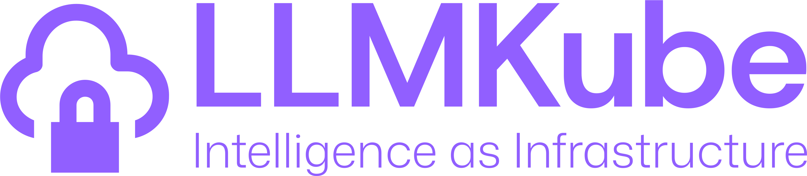
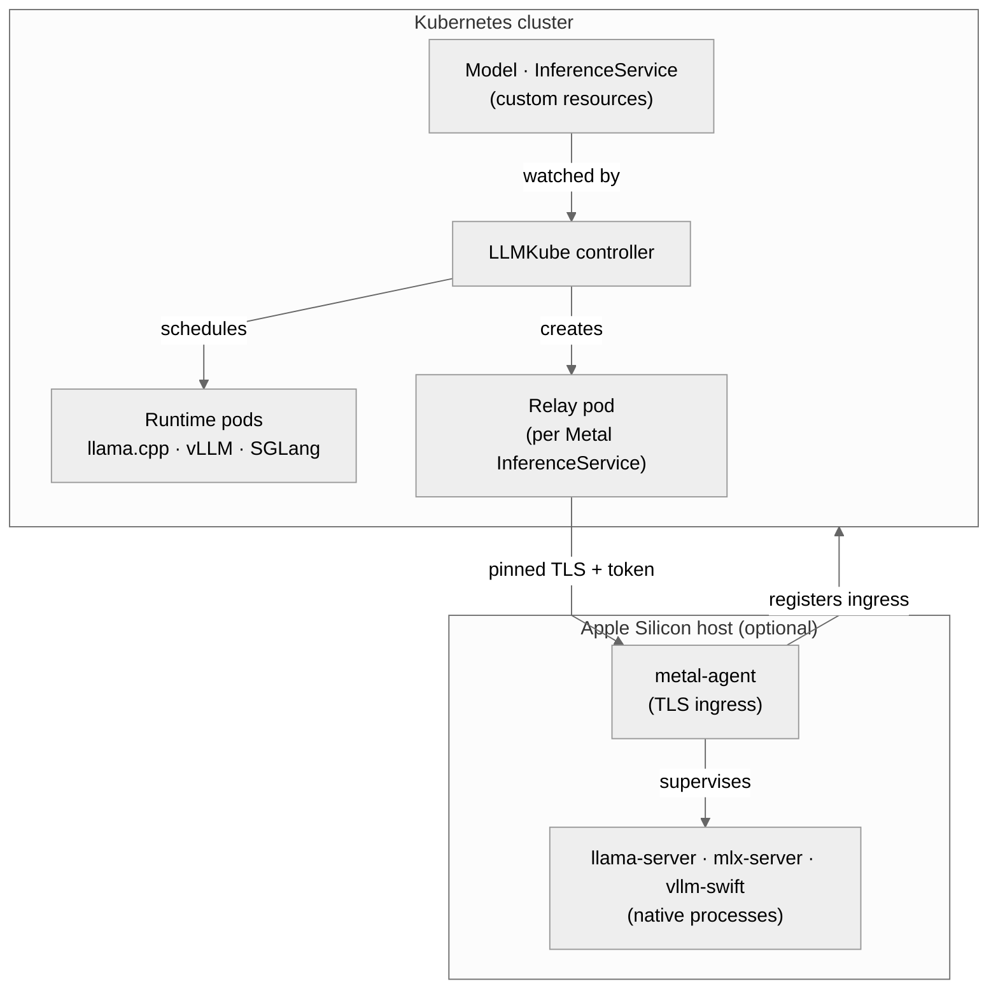
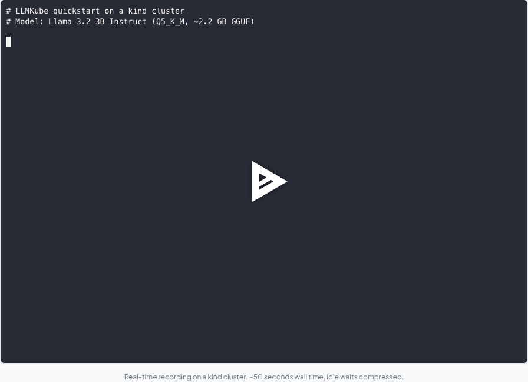

<div align="center">
  

  # LLMKube

  ### The Kubernetes operator for self-hosted LLM inference

  **Run models across NVIDIA, Apple Silicon, and AMD from one spec. Your models. Your hardware. Your rules.**

  Three things no other Kubernetes LLM operator combines: Apple Silicon inference as **native macOS processes, not containers** (the [Metal Agent](#the-metal-agent) runs `llama-server`, `mlx-server`, and `vllm-swift` with full Metal GPU access); **heterogeneous fleets** of NVIDIA, AMD (Vulkan), Intel, and Apple Silicon hosts under one operator and one set of CRDs; and **fail-closed policy routing** between local and external models via [ModelRouter](#composition-modelrouter).

  **Who it's for:** platform and AI-ops teams running on-prem, mixed-hardware, or air-gapped inference. If you want one model on one laptop, Ollama is simpler.

  *Plus [Foreman](#foreman): an agentic harness that runs coding agents on your own fleet. It has shipped real fixes to this repo.*

  <p>
    <a href="https://github.com/defilantech/LLMKube/actions/workflows/test.yml">
      
    </a>
    <a href="https://github.com/defilantech/LLMKube/actions/workflows/helm-chart.yml">
      
    </a>
    <a href="https://goreportcard.com/report/github.com/defilantech/llmkube">
      
    </a>
    <a href="https://github.com/defilantech/LLMKube/releases">
      
    </a>
    <a href="https://github.com/defilantech/LLMKube/stargazers">
      
    </a>
    <a href="LICENSE">
      
    </a>
    
    <a href="https://discord.gg/Ktz85RFHDv">
      
    </a>
  </p>

  <p>
    <a href="#quick-start">Quick Start</a> &bull;
    <a href="#project-status">Status</a> &bull;
    <a href="#composition-modelrouter">ModelRouter</a> &bull;
    <a href="#foreman">Foreman</a> &bull;
    <a href="#the-metal-agent">Metal Agent</a> &bull;
    <a href="#how-is-this-different">Why LLMKube?</a> &bull;
    <a href="#performance">Benchmarks</a> &bull;
    <a href="ROADMAP.md">Roadmap</a> &bull;
    <a href="https://discord.gg/Ktz85RFHDv">Discord</a>
  </p>

</div>

---

> **Status:** pre-1.0. Every CRD is `v1alpha1`, and fields can change between minor releases. See [Project status](#project-status) for what CI tests and how often releases ship.

## The Problem

You want to run LLMs on your own infrastructure. Maybe it's for data privacy, cost control, air-gapped compliance, or you just don't want to send every request to OpenAI.

So you set up llama.cpp. It works great on one machine. Then you need to scale it, monitor it, manage model versions, handle GPU scheduling across nodes, expose an API, and somehow make your Mac's Metal GPU and your Linux server's NVIDIA cards work together. And the moment you want any of that traffic to *sometimes* hand off to Claude or GPT, you're building another routing layer.

Suddenly you're building an entire platform instead of shipping your product.

**LLMKube is a Kubernetes operator that turns LLM deployment into a two-resource YAML problem.** Define a `Model` and an `InferenceService`, and the operator handles downloading, caching, GPU scheduling, health checks, scaling, and exposing an OpenAI-compatible API. Add a `ModelRouter` on top and the same cluster does policy-aware routing between your local models and external providers (Anthropic / OpenAI / LiteLLM). A rule that matches requests labeled pii/phi (by header) can route only to local-tier backends; content detection is planned ([#441](https://github.com/defilantech/LLMKube/issues/441)).

---

## Architecture

Two cooperating processes. An in-cluster controller owns Kubernetes-side desired state. An out-of-cluster `metal-agent` (optional, only needed for Apple Silicon hosts) owns OS-level process supervision and registers its authenticated ingress back into the cluster; the controller fronts that ingress with an in-cluster relay, so Metal InferenceServices are ordinary Services.



Same operator manages Linux/GPU pods and Apple Silicon hosts; both surface as `InferenceService` objects to `kubectl`.

Setup guide for the metal-agent on Apple Silicon: [`deployment/macos/README.md`](deployment/macos/README.md).

---

## See it in action

[](https://llmkube.com/docs/getting-started)

*Live asciinema cast on [llmkube.com/docs/getting-started](https://llmkube.com/docs/getting-started): deploy a model on a kind cluster, stream tokens from the OpenAI-compatible endpoint, and run the built-in throughput benchmark in under a minute (recorded with the model weights already downloaded).*

---

## Quick Start

```bash
# Install the CLI
brew install defilantech/tap/llmkube

# Install the operator on any K8s cluster
helm repo add llmkube https://defilantech.github.io/LLMKube
helm install llmkube llmkube/llmkube --namespace llmkube-system --create-namespace

# Deploy a model (one command, uses catalog-tested defaults)
llmkube deploy phi-4-mini

# Query it (OpenAI-compatible)
kubectl port-forward svc/phi-4-mini 8080:8080 &
curl http://localhost:8080/v1/chat/completions \
  -H "Content-Type: application/json" \
  -d '{"messages":[{"role":"user","content":"Hello!"}],"max_tokens":100}'
```

That's it. The operator creates the Deployment and the Service, the pod's init container downloads the model, and llama.cpp serves an OpenAI-compatible API. Works with the OpenAI Python/Node/Go SDKs, LangChain, and LlamaIndex out of the box.

The first deploy downloads the weights (about 2.8 GB for phi-4-mini) into a `llmkube-model-cache` PersistentVolumeClaim that the operator creates in your namespace (100Gi request by default). That claim is not removed with the model or by `helm uninstall`. On a slow link the download takes several minutes; `llmkube deploy` waits up to 10 minutes by default (`--timeout`).

**Want GPU acceleration?** Add `--gpu`:

```bash
llmkube deploy llama-3.1-8b --gpu --gpu-count 1
```

On a Mac that has the Metal Agent installed, `--gpu` picks Metal; add `--accelerator cuda` to target NVIDIA nodes.

<details>
<summary><b>No CLI? Use plain kubectl</b></summary>

```yaml
apiVersion: inference.llmkube.dev/v1alpha1
kind: Model
metadata:
  name: tinyllama
spec:
  source: https://huggingface.co/TheBloke/TinyLlama-1.1B-Chat-v1.0-GGUF/resolve/main/tinyllama-1.1b-chat-v1.0.Q4_K_M.gguf
  format: gguf
---
apiVersion: inference.llmkube.dev/v1alpha1
kind: InferenceService
metadata:
  name: tinyllama
spec:
  modelRef: tinyllama
  replicas: 1
  resources:
    cpu: "500m"
    memory: "1Gi"
```

```bash
kubectl apply -f model.yaml
```
</details>

**Full setup guides:** [Minikube Quickstart](docs/minikube-quickstart.md) | [GKE with GPUs](docs/gpu-setup-guide.md) | [Intel GPU Quickstart](docs/intel-gpu-quickstart.md) | [DGX Spark (MicroK8s)](docs/dgx-spark-microk8s.md) | [Air-Gapped Deployment](docs/air-gapped-quickstart.md) | [OpenShift](#troubleshooting)

---

## Project status

- **Pre-1.0 API:** every CRD is `v1alpha1`. Fields can change between minor releases; breaking changes are listed under "BREAKING CHANGES" in the [CHANGELOG](CHANGELOG.md) (0.9.0 and 0.10.0 are recent examples).
- **What CI covers:** on every pull request the default end-to-end job deploys the operator to a kind cluster and checks `Model` and `InferenceService` reconciliation, the CLI catalog, and ModelRouter proxy routing against a stub backend. It runs no real model and no GPU. GPU paths are exercised on lab hardware, and the [lab builds](https://llmkube.com/docs/labs) record what ran, on which machines, and when. No component carries a formal stability level yet. Newer features state their limits in their guides: for example, [multi-node inference](docs/site/guides/multi-node-inference.md) is vLLM only, and the ModelRouter Gateway and AgentGateway data planes support a subset of the proxy's routing strategies.
- **Kubernetes versions:** CI runs kind from its `latest` download link with kind's default node image, neither pinned (Kubernetes v1.37.0 in November 2026), plus a best-effort MicroShift job. Older versions are not tested in CI. Some features need newer clusters: DRA needs 1.34+, and `oci://` model sources need 1.36+.
- **Releases ship often**, sometimes several a week, and new features land in patch releases (0.10.x). See the [latest release](https://github.com/defilantech/LLMKube/releases/latest) for what is current.
- **First-time contributors have landed real features:** Intel oneAPI / SYCL GPU support arrived as PR [#557](https://github.com/defilantech/LLMKube/pull/557) from a first-time contributor, and configurable GPU resource names for AMD/Vulkan/Intel scheduling as [#709](https://github.com/defilantech/LLMKube/pull/709) from a contributor new to the repo, who followed with vendor-neutral DRA scheduling in [#750](https://github.com/defilantech/LLMKube/pull/750).
- **Foreman, the agentic harness, contributes code to this repository:** its first two merged PRs landed in May 2026 ([#508](https://github.com/defilantech/LLMKube/pull/508), [#588](https://github.com/defilantech/LLMKube/pull/588)), with more Foreman-authored PRs merging since.
- **Running LLMKube in production, a lab, or a homelab?** [Add yourself to ADOPTERS.md](ADOPTERS.md).

---

## The Metal Agent

> **We know of no other Kubernetes LLM operator that does this.**

Most Kubernetes tools run inference inside containers. That works fine on Linux with NVIDIA GPUs. But Apple Silicon's Metal GPU can't be accessed from inside a container, so Kubernetes tools either ignore Macs or fall back to slow CPU-only inference.

LLMKube's **Metal Agent** inverts the model. Instead of stuffing inference into a container, the Metal Agent runs as a native macOS process that:

1. **Watches the Kubernetes API** for `InferenceService` resources whose `Model` sets `hardware.accelerator: metal`
2. **Spawns the engine natively** on macOS with full Metal GPU access (`llama-server` by default)
3. **Registers its authenticated ingress back into Kubernetes**; the controller fronts it with an in-cluster relay, so the rest of your cluster calls an ordinary Service

The model runs on the Mac's unified memory with no container VM in between; the agent budgets 67% to 75% of it for models by default (`--memory-fraction`). Kubernetes handles orchestration. The same CRD works across NVIDIA, Intel, and Apple Silicon by selecting the accelerator in the model spec.

```
┌──────────────────────────────┐      ┌──────────────────────────────┐
│ Linux Server / Cloud         │      │ Mac (Apple Silicon)          │
│                              │      │                              │
│  ┌────────────────────────┐  │      │  ┌────────────────────────┐  │
│  │ Kubernetes             │  │ LAN/ │  │ Metal Agent            │  │
│  │  LLMKube Operator      │◄─┼──────┼─►│  Watches K8s API       │  │
│  │  Model Controller      │  │ VPN  │  │  Spawns llama-server   │  │
│  │  InferenceService Ctrl │  │      │  └────────────────────────┘  │
│  └────────────────────────┘  │      │                              │
│                              │      │  ┌────────────────────────┐  │
│  ┌────────────────────────┐  │      │  │ llama-server (Metal)   │  │
│  │ NVIDIA Nodes           │  │      │  │  Full GPU access       │  │
│  │  llama.cpp (CUDA)      │  │      │  │  Unified memory        │  │
│  └────────────────────────┘  │      │  └────────────────────────┘  │
└──────────────────────────────┘      └──────────────────────────────┘
```

This means you can build a heterogeneous cluster: NVIDIA GPUs in the cloud for heavy workloads, Mac Studios on-prem for low-latency inference, all managed by the same Kubernetes operator with the same CRDs.

```bash
brew install defilantech/tap/llmkube defilantech/tap/llmkube-metal-agent  # on the Mac
llmkube metal token create <mac>   # where you have cluster access; prints a single-use join string
llmkube metal join <join-string>   # on the Mac
```

`llmkube metal join` installs and starts the agent as a LaunchAgent and waits until the cluster reports the Mac Reachable; after that, `llmkube deploy <model> --accelerator metal` serves on it, and the **[macOS guide](https://llmkube.com/docs/guides/macos-metal)** covers networking (LAN, Tailscale, WireGuard), memory budgets and troubleshooting.

---

## Composition: ModelRouter

`Model` and `InferenceService` give you self-hosted inference. `ModelRouter` puts a policy-aware OpenAI-compatible endpoint in front of *both* your local InferenceServices and external providers, with budgets, classifications, and fail-closed semantics enforced at the cluster level instead of in application code.

The motivating use case: an agent running on a local model can selectively hand off specific steps to Claude or GPT without the agent code knowing or caring where the model lives, while a fail-closed platform rule keeps requests labeled pii/phi (by header) on local-tier backends. Content detection is planned ([#441](https://github.com/defilantech/LLMKube/issues/441)).

```yaml
apiVersion: inference.llmkube.dev/v1alpha1
kind: ModelRouter
metadata:
  name: coding-router
spec:
  backends:
    - name: local-coder
      inferenceServiceRef: { name: qwen3-coder }
      tier: local
      capabilities: [code, tools]
    - name: cloud-opus
      external:
        provider: anthropic
        model: claude-opus-4-7
        credentialsSecretRef: { name: anthropic-key }
      tier: cloud
  rules:
    - name: pii-stays-local
      match: { dataClassification: [pii] }
      route: { backends: [local-coder] }
      failClosed: true
      timeout: 8s
    - name: complex-to-cloud
      match: { taskComplexity: complex }
      route:
        backends: [cloud-opus, local-coder]
        strategy: primary-fallback
      timeout: 90s
  defaultRoute: local-coder
```

Three properties worth calling out:

- **Fail-closed for requests labeled pii/phi.** A request carries its classification in a header (`x-llmkube-classification` by default); content detection is planned ([#441](https://github.com/defilantech/LLMKube/issues/441)). Apply-time validation rejects a rule that matches pii/phi unless it is fail-closed and routes only to local-tier backends, and the proxy repeats the check on every request: if the local backends can't serve it, the answer is HTTP 503, never a fall-through to cloud. Rules match in order and the default route is not fail-closed, so put the pii/phi rule ahead of rules that send traffic to cloud and keep `defaultRoute` local.
- **Per-rule and per-backend timeout budgets.** Strict policy tiers fast-fail; lenient tiers stay patient. The proxy applies `context.WithTimeout` per attempt, so a slow primary doesn't eat the fallback's budget. Resolution order: `rule.timeout || backend.timeout || proxy default`.
- **OpenAI-compatible streaming endpoint.** Plug it into LangGraph, OpenAI Agents SDK, Anthropic SDK, Cline, Aider, or any framework that speaks the OpenAI API. The agent runtime doesn't need to know it's talking to a router.

**[Full ModelRouter concept doc →](docs/site/concepts/model-router.md)** | **[Sample manifest](config/samples/inference_v1alpha1_modelrouter.yaml)**

---

## Foreman


`Model` and `InferenceService` give you self-hosted inference. `ModelRouter` gives you policy-aware routing. **Foreman gives you an orchestrator for agentic workloads on top of both.**

Foreman is an opt-in add-on that ships its own Helm chart, its own API group (`foreman.llmkube.dev`), and its own controller and node-agent binaries. It introduces four CRDs (`Workload`, `AgenticTask`, `Agent`, `FleetNode`), a capability-aware scheduler, and a native Go agent loop that runs OpenAI function-calling against your local inference endpoints. The v0.1 shape is a linear pipeline: coder agent on one node produces a branch, verifier agent (gate) on another node runs `make fmt vet lint test`, reviewer agent(s) on a third node read the diff against the issue body and score it.

```yaml
apiVersion: foreman.llmkube.dev/v1alpha1
kind: Workload
metadata:
  name: fix-small-bugs
  namespace: default
spec:
  intent: "Fix small open issues"
  repo: defilantech/LLMKube
  issues: [510, 526, 449]
  coderAgentRef:    { name: qwen36-35b-carnice-mtp-coder }
  verifierAgentRef: { name: shadowstack-gate }
  reviewerAgentRefs:
    - { name: qwen36-35b-a3b-reviewer }
    - { name: devstral-24b-reviewer }
```

`kubectl apply` and watch the fleet land DCO-signed branches on a fork. Foreman's debut branches landed as upstream PRs [#508](https://github.com/defilantech/LLMKube/pull/508) and [#588](https://github.com/defilantech/LLMKube/pull/588) in May 2026, and the pipeline has merged Foreman-authored PRs ever since.

Foreman is meant for shops where on-prem hardware, sovereignty constraints, or sheer batch scale make the agentic-coding cloud-API model a poor fit. It is not a replacement for individual-developer tools like Cursor or aider; it is the control plane *below* those tools, for when you want a fleet doing the work instead of one developer.

**[Full Foreman docs →](https://llmkube.com/docs/foreman)** | **[Model compatibility table](https://llmkube.com/docs/foreman/model-compatibility)** | **[Sample manifests](examples/foreman/)**

---

## How Is This Different?

**LLMKube is for teams that want Kubernetes-managed LLM inference across heterogeneous hardware.** What it combines:

- **Apple Silicon in the same control plane as your GPU nodes.** The Metal Agent runs engines as native macOS processes, and the controller fronts each one with an ordinary Service, so a Mac and an NVIDIA node both show up as `InferenceService` objects.
- **Several runtimes under one CRD.** llama.cpp, vLLM and SGLang in-cluster, MLX engines and Ollama on Macs (see [Features](#features) for the full list).
- **Local and external models behind one endpoint.** `ModelRouter` routes between your InferenceServices and Anthropic, OpenAI, Bedrock, Vertex AI or LiteLLM backends, with per-rule timeouts and fallback.

If you just need to run a model on one machine, Ollama is simpler. If you need maximum throughput on NVIDIA-only clusters, vLLM on its own is faster. **[How LLMKube compares](https://llmkube.com/docs/concepts/comparison)** sets it against KubeAI, llm-d, Ollama and the NVIDIA NIM Operator capability by capability, and says when each of them is the better pick.

**Versus newer adjacent projects:**
- **KubeAI**: similar Kubernetes-operator scope, focused on autoscaling vLLM and Ollama in Linux containers; it scales to zero with request queuing, which LLMKube does not do today. LLMKube adds Apple Silicon through the Metal Agent, a model catalog CLI, and `ModelRouter` for routing across local and external models.
- **llm-d**: distributed inference for very large models on datacenter accelerators (NVIDIA, AMD, Intel, TPU) via Gateway API. Different problem space. LLMKube targets heterogeneous on-prem clusters (laptops, edge nodes, single GPUs) where llm-d's disaggregated multi-node design is more than you need.
- **LiteLLM**: a widely used provider proxy that operates outside Kubernetes policy. LLMKube doesn't replace LiteLLM; `ModelRouter` composes with it: declare a `provider: litellm` backend pointed at a running LiteLLM proxy and the platform-level fail-closed gate sits in front.

---

## Performance

These are historical llama.cpp numbers from November 2025 (LLMKube v0.2.0 and v0.4.0). They show what the runtime did on that hardware at the time, not operator overhead, and they have not been re-run on the current release. The [lab builds](https://llmkube.com/docs/labs) have current, dated measurements.

### Cloud GPU (GKE, NVIDIA L4), v0.2.0

Llama 3.2 3B Instruct Q8_0, the same model on CPU and on the L4. The CPU node type for this comparison was not recorded. Source: [v0.2.0 release notes](docs/releases/RELEASE_NOTES_v0.2.0.md).

| Metric | CPU | GPU (NVIDIA L4) | Speedup |
|--------|-----|-----------------|---------|
| Token generation | 4.6 tok/s | **64 tok/s** | **14x** |
| Prompt processing | 15.5 tok/s | **1,026 tok/s** | **66x** |
| Total response time | 10.3s | **0.6s** | **17x** |

### Desktop GPU (two RTX 5060 Ti), v0.4.0

One machine with two RTX 5060 Ti GPUs, 10 iterations of 256 max tokens per model. The notes do not record each model's quantization or how many of the two GPUs it used. Source: [v0.4.0 release notes](docs/releases/RELEASE_NOTES_v0.4.0.md), which also describe the multi-GPU setup.

| Model | Size | Tokens/s | P50 Latency | P99 Latency |
|-------|------|----------|-------------|-------------|
| Llama 3.2 3B | 3B | **53.3** | 1930ms | 2260ms |
| Mistral 7B v0.3 | 7B | **52.9** | 1912ms | 2071ms |
| Llama 3.1 8B | 8B | **52.5** | 1878ms | 2178ms |

---

## Features

**Inference:**
- Kubernetes-native CRDs, all `v1alpha1`: `Model` and `InferenceService` at the core; the Helm chart also installs `ModelRouter`, `ModelPool`, `GPUQuota`, `LoRAAdapter`, `MetalNode` and `FederatedCluster` (Foreman's CRDs come with its own chart)
- In-cluster runtimes: llama.cpp (GGUF, plus a router mode that serves several models from one server), vLLM, SGLang, PersonaPlex (Moshi speech-to-speech; bring your own image), and any container (`generic`). TGI is still accepted as a legacy runtime: upstream archived it, and the operator pins its final release, 3.3.7
- On Apple Silicon through the Metal Agent: llama-server, mlx-server, oMLX, vllm-swift, Ollama and TensorFold, as native processes
- Model sources: `http(s)://`, `hf://`, `s3://` (S3-compatible stores), `pvc://`, `oci://` (image volumes, Kubernetes 1.36+), and `file://` or absolute paths under allowlisted host roots
- Persistent model cache, download once, deploy instantly ([guide](docs/MODEL-CACHE.md))
- OpenAI-compatible `/v1/chat/completions` API
- Multi-replica horizontal scaling with scale subresource support (`kubectl scale`, KEDA)
- License compliance scanning for GGUF models

**Routing & policy ([ModelRouter](#composition-modelrouter)):**
- `ModelRouter` CRD: one OpenAI-compatible endpoint, multiple backends (local InferenceServices + external Anthropic / OpenAI / Bedrock / LiteLLM)
- Policy-aware rules: data classification, task complexity, required capabilities, arbitrary header match
- Fail-closed rules for requests labeled pii/phi (by header): checked at apply time and on every request, HTTP 503 instead of cloud fallback; content detection is planned ([#441](https://github.com/defilantech/LLMKube/issues/441))
- Per-rule and per-backend timeout budgets (`spec.rules[].timeout` / `spec.backends[].timeout`)
- Half-open circuit breaker with configurable quarantine window
- Audit log on every request: rule, backend, tier, resolved timeout, outcome
- Streaming SSE passthrough from day one

**GPU:**
- NVIDIA CUDA (T4, L4, A100, RTX)
- AMD GPUs with llama.cpp Vulkan or ROCm images, including Strix Halo ([guide](docs/amd-rocm-quickstart.md))
- Intel GPU (i915 or xe plugin resources) with llama.cpp SYCL backend
- Apple Silicon (M-series) Metal via [Metal Agent](deployment/macos/)
- Multi-GPU inference for 13B-70B+ models ([guide](docs/MULTI-GPU-DEPLOYMENT.md))
- Multi-node inference: one model across several nodes with `spec.multiNode` (vLLM) ([guide](docs/site/guides/multi-node-inference.md))
- Automatic layer offloading and tensor splitting
- GPU queue management with priority classes
- DRA passthrough (resource.k8s.io/v1) for CRI-based device scheduling (Kubernetes 1.34+)

**Operations:**
- Full CLI: `llmkube deploy/list/status/delete/catalog/cache/queue`
- Model catalog of pre-configured GGUF models for llama.cpp (`llmkube catalog list`)
- Prometheus metrics + OpenTelemetry tracing of ModelRouter proxy requests ([details](docs/observability/tracing.md))
- For an existing Prometheus Operator or kube-prometheus-stack: Grafana dashboards (inference, llama.cpp, vLLM, SGLang, ModelRouter, GPU quota, SLOs, AMD GPU), PodMonitors, a ServiceMonitor and PrometheusRule alerts. All of them are off by default (`prometheus.*.enabled`, `grafana.dashboards.enabled`), and Prometheus and Grafana themselves are not bundled
- GPU alert rules on DCGM exporter metrics (utilization, temperature, power, memory, Xid faults)
- Per-service SLOs through Pyrra (`spec.slo`; needs Pyrra installed and `pyrra.enabled`)
- Custom CA certificates for corporate environments
- Example Terraform for GPU clusters on GKE, AKS and EKS (`terraform/`; last changed November 2025, not tested in CI)
- Cost controls: scale a service to zero by hand (`kubectl scale isvc <name> --replicas=0`) or with KEDA on the scale subresource, and target spot or preemptible node pools with `nodeSelector` and `tolerations`. There is no automatic idle scale-to-zero

---

## Use the API

Every deployment exposes an OpenAI-compatible API. Use any OpenAI SDK:

```python
from openai import OpenAI

# Through the port-forward from Quick Start. Inside the cluster, use the
# endpoint `llmkube status phi-4-mini` prints:
# http://phi-4-mini.<namespace>.svc.cluster.local:8080/v1
client = OpenAI(
    base_url="http://localhost:8080/v1",
    api_key="not-needed"
)

response = client.chat.completions.create(
    model="phi-4-mini",
    messages=[{"role": "user", "content": "Explain Kubernetes in one sentence"}]
)
```

Works with LangChain, LlamaIndex, and any OpenAI-compatible client library.

---

## Installation

### Helm (Recommended)

```bash
helm repo add llmkube https://defilantech.github.io/LLMKube
helm install llmkube llmkube/llmkube --namespace llmkube-system --create-namespace
```

### CLI

```bash
# macOS
brew install defilantech/tap/llmkube

# Linux / macOS
curl -sSL https://raw.githubusercontent.com/defilantech/LLMKube/main/install.sh | bash
```

### From Source

Needs Go 1.27.3 or later (the version `go.mod` pins).

```bash
git clone https://github.com/defilantech/LLMKube.git && cd LLMKube
make install  # Install CRDs
make run      # Run controller locally
```

[Helm Chart docs](charts/llmkube/README.md) | [Minikube Quickstart](docs/minikube-quickstart.md) | [GKE GPU Setup](docs/gpu-setup-guide.md)

---

## Troubleshooting

<details>
<summary><b>Model won't download</b></summary>

```bash
kubectl describe model <model-name>
kubectl logs <pod-name> -c model-downloader
```
Common causes: HuggingFace URL needs auth (use direct links), insufficient disk space, network timeout (auto-retries).
</details>

<details>
<summary><b>Pod OOM crash</b></summary>

```bash
llmkube deploy <model> --memory 8Gi  # Rule of thumb: file size x 1.2
```
</details>

<details>
<summary><b>GPU not detected</b></summary>

```bash
kubectl get pods -n gpu-operator-resources
kubectl get pods -n kube-system -l name=nvidia-device-plugin-ds
```
</details>

<details>
<summary><b>OpenShift / MicroShift / OKD: ship the bundled Helm preset</b></summary>

LLMKube's CI exercises the OpenShift SCC admission path end-to-end against MicroShift on every PR, in a best-effort job (`continue-on-error`) that does not fail the build. The repo ships a Helm values preset at `charts/llmkube/values-openshift.yaml` that disables the operator's default `fsGroup` so the `restricted-v2` SCC can inject an appropriate value from the namespace's allocated supplemental-groups range.

**Recommended install:**

```bash
helm install llmkube ./charts/llmkube \
  -f charts/llmkube/values-openshift.yaml \
  -n llmkube-system --create-namespace
```

That single command produces an LLMKube deployment whose InferenceService pods are admitted cleanly under `restricted-v2`. The same `values-openshift.yaml` works on MicroShift, OKD, OpenShift Container Platform, and any other distribution that runs the SCC admission controller with the standard `MustRunAs` fsGroup strategy.

**Per-InferenceService override (fallback for single-tenant cases).**

If you would rather pin `fsGroup` per workload instead of disabling the default operator-wide:

```bash
# Find your namespace's supplemental-groups range
oc get namespace <namespace> -o jsonpath='{.metadata.annotations.openshift\.io/sa\.scc\.supplemental-groups}'
```

```yaml
apiVersion: inference.llmkube.dev/v1alpha1
kind: InferenceService
metadata:
  name: my-service
spec:
  modelRef: my-model
  podSecurityContext:
    fsGroup: 1000680000  # first value from the command above
```

**What the preset does, in one line.** Sets `controllerManager.initContainer.defaultFSGroup: 0` so the SCC admission controller is the authoritative source of `fsGroup`, not the operator's default of 102 (which is correct for non-OpenShift clusters and would be rejected by `restricted-v2`).
</details>

---

## Contributing

We welcome contributions. See [CONTRIBUTING.md](CONTRIBUTING.md) for the full guide.

**Good first issues:**
- Documentation and tutorials
- Model catalog additions
- Testing on different K8s platforms
- Example applications (chatbot UI, RAG pipeline)

**Advanced:**
- K3s edge deployment
- llama.cpp members for `spec.multiNode` (multi-node inference supports vLLM today)

### Contributors

Thanks to the people who've shipped code, tests, and docs:

<a href="https://github.com/defilantech/LLMKube/graphs/contributors">
  
</a>

---

## Community

- **Chat:** [Discord](https://discord.gg/Ktz85RFHDv)
- **Bug reports & features:** [GitHub Issues](https://github.com/defilantech/LLMKube/issues)
- **Questions & discussion:** [GitHub Discussions](https://github.com/defilantech/LLMKube/discussions)
- **Roadmap:** [ROADMAP.md](ROADMAP.md)

---

## Security

- [Verifying releases](docs/security/verifying-releases.md) - cosign signatures, SLSA provenance, SBOM.

---

## Acknowledgments

Built on [Kubebuilder](https://kubebuilder.io), [llama.cpp](https://github.com/ggml-org/llama.cpp), [Prometheus](https://prometheus.io), and [Helm](https://helm.sh).

## License

Apache 2.0. See [LICENSE](LICENSE).

## Trademarks

LLMKube is not affiliated with or endorsed by the Cloud Native Computing Foundation or the Kubernetes project. Kubernetes is a registered trademark of The Linux Foundation. All other trademarks are the property of their respective owners.

<div align="center">

**[Get started →](https://llmkube.com/docs/getting-started)**

If LLMKube is useful to you, **[a star helps others find it](https://github.com/defilantech/LLMKube)**.

</div>
